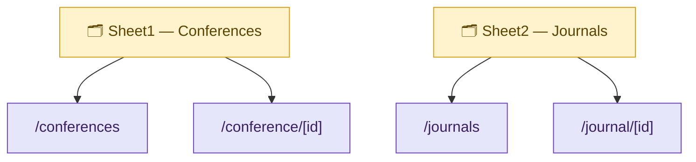
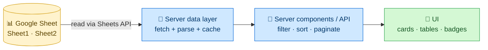
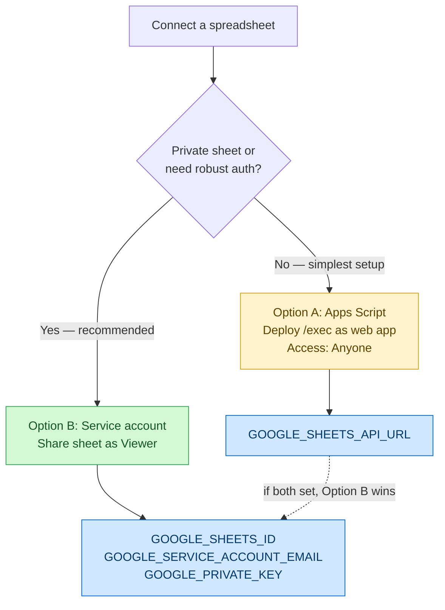
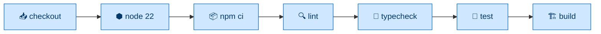
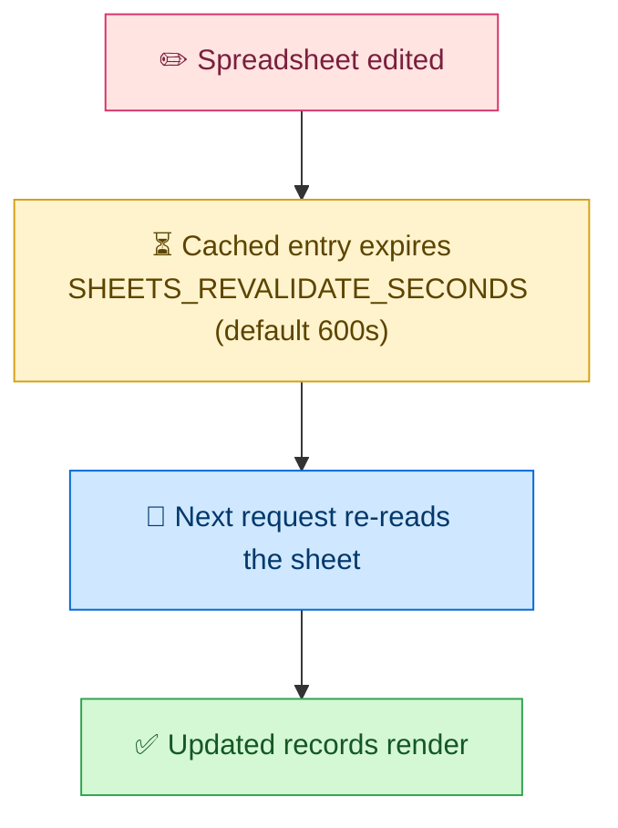

<div align="center">

# 🎓 Conference Finder

**A searchable index of academic conferences and journals — maintained in a Google Sheet, published as a fast, filterable website.**


</div>

---

## 📚 Table of contents

- [Overview](#overview)
- [Features](#features)
- [Architecture](#architecture)
- [Tech stack](#tech-stack)
- [Project structure](#project-structure)
- [Google Sheets setup](#google-sheets-setup)
- [Environment variables](#environment-variables)
- [Groq AI setup](#groq-ai-setup)
- [Local development](#local-development)
- [Testing](#testing)
- [GitHub Actions (CI)](#github-actions-ci)
- [Vercel deployment](#vercel-deployment)
- [Data refresh behaviour](#data-refresh-behaviour)
- [Security](#security)
- [Customising](#customising)
- [Troubleshooting](#troubleshooting)
- [A note on the data](#a-note-on-the-data)

---

## 🧭 Overview

Finding somewhere to submit a paper usually means twenty browser tabs and a scratch document of deadlines. This site **is** that document, made searchable.

The spreadsheet is the source of truth. Editors work in Google Sheets — nobody has to touch code to add a conference or a journal.

Two tabs in one spreadsheet drive the whole site:

| 🗂️ Spreadsheet tab | Powers | Routes |
| --- | --- | --- |
| `Sheet1` (Conferences) | Conference records | `/conferences`, `/conference/[id]` |
| `Sheet2` (Journals) | Journal records | `/journals`, `/journal/[id]` |

> Tab names are configurable — see [Environment variables](#environment-variables).



---

## ✨ Features

- 🔎 **Conference discovery** — deadline-first sorting, card and table layouts, filters for country, city, participation mode, topic, organiser and year.
- 📖 **Journal discovery** — filters for publisher, subject, indexing database, quartile, access model and minimum impact factor.
- 🌐 **Unified search** at `/search`, switchable between conferences and journals. Every filter lives in the URL, so searches are shareable and bookmarkable.
- ⏱️ **Honest deadline badges** — "12 days left", "Closes today", "Deadline passed", or "Deadline not listed" when the sheet has no parseable date. No invented countdowns.
- 🧩 **Tolerant parsing** — Excel serial dates, prose dates, `;`-separated topics, ISSN pairs and impact factors written as sentences all parse correctly. One malformed row is skipped, never fatal.
- 🌓 **Three-mode theme** — light, dark, and follow-the-system, with no flash on first paint.
- 🤖 **Optional AI assistant** — a small Groq-backed helper for publishing terminology. Absent entirely when no key is configured.
- 🏷️ **SEO** — per-record metadata, Open Graph, sitemap and robots.

---

## 🏗️ Architecture



Editors never touch code — they edit rows in Google Sheets. The server layer reads, parses, and caches that data; server components and API routes filter, sort, and paginate it; the UI renders it as cards, tables, and badges.

### Choosing a Sheets access method



---

## 🧰 Tech stack

| Concern | Choice |
| --- | --- |
| 🧱 Framework | Next.js 16 (App Router, React 19) |
| 🔤 Language | TypeScript, strict |
| 🎨 Styling | Tailwind CSS v4 with CSS custom properties |
| 🔡 Fonts | Source Serif 4 + IBM Plex Sans, self-hosted via npm |
| 🧷 Icons | lucide-react |
| 📊 Data | Google Sheets (service account or Apps Script) |
| 🤖 AI | Groq HTTP API, server-side only |
| 🧪 Tests | Vitest + Testing Library |
| ⚙️ CI | GitHub Actions |
| ☁️ Hosting | Vercel |

> Fonts are installed from npm rather than fetched by `next/font/google`. That keeps builds reproducible offline and in restricted CI networks, and means the Content Security Policy needs no third-party font origin.

---

## 📁 Project structure

```
app/
  page.tsx                  Home: hero, closing deadlines, featured records
  conferences/               Conference listing (cards or table)
  journals/                  Journal listing
  conference/[id]/           Conference detail
  journal/[id]/              Journal detail
  search/                     Unified search
  about/                       About + founder profiles
  faq/                         How the data works
  api/
    conferences/               JSON listing API
    journals/                  JSON listing API
    ai/                         Groq proxy (POST) + status flag (GET)
    revalidate/                Force a cache refresh (secret-protected)
  sitemap.ts, robots.ts
components/
  search/                     URL-driven search, filters, chips, toggles
  theme/                       Three-mode theme with no-flash script
  assistant/                   Optional AI assistant, server-gated
  ui/                           Badge, Button primitives
config/
  site.ts                     Name, nav, description, base URL
  profiles.ts                  Founder profiles  ← edit this
lib/
  sheets/                      Google Sheets adapters + row mappers
  data.ts                      Cached data layer with fallback
  search.ts                    Pure filter / sort / facet / paginate
  dates.ts                     Date parsing and deadline logic
  parse.ts                     Cell normalisation helpers
  ai.ts, rate-limit.ts        Server-side AI and throttling
types/                        Conference, Journal, filters, profiles, API
data/                          Bundled sample rows (development fallback)
tests/                         Vitest suites
```

---

## 📊 Google Sheets setup

### Spreadsheet schema

Create one spreadsheet with two tabs. Row 1 holds the headers.

#### Conferences tab (`Sheet1`)

| Column | Required | Notes |
| --- | :---: | --- |
| `CONFERENCE NAME` | ✅ | Rows without a name are skipped |
| `CONFERENCE LINK` | – | One or more URLs; non-URL text is ignored |
| `Last Date - Paper Submission` | – | Drives the deadline badge |
| `CONFERENCE DATE` | – | |
| `PAPER SIZE` | – | |
| `PAPER FORMAT` | – | |
| `CONFERENCE TOPICS` | – | Separate with `;` |
| `MODE` | – | Free text; normalised to In-person / Online / Hybrid |
| `CONFERENCE PLACE` | – | `Venue, City, State, Country` |
| `CONFERENCE FEES` | – | |

#### Journals tab (`Sheet2`)

| Column | Required | Notes |
| --- | :---: | --- |
| `JOURNAL NAME` | ✅ | Rows without a name are skipped |
| `JOURNAL LINK` / `JOURNAL WEBSITE` | – | |
| `PUBLISHER` | – | |
| `ISSN` | – | `0031-3203 (E-ISSN: 1873-5142)` splits automatically |
| `JOURNAL SCOPE` | – | Used as the description |
| `RESEARCH AREAS` | – | Separate with `;` |
| `PUBLICATION FREQUENCY` | – | |
| `OPEN ACCESS` | – | Normalised to Open Access / Hybrid / Subscription |
| `APC / PUBLICATION FEE` | – | |
| `JOURNAL FEES`, `PAPER SIZE`, `JOURNAL VOLUME` | – | |
| `INDEXING` | – | Known databases are recognised inside prose |
| `IMPACT FACTOR` | – | Leading number is parsed; full text is shown |
| `SUBMISSION TYPE` | – | |

Optional extras on either tab: `id`, `featured`, `verified`, `last_updated`, `description`, `organizer`, `city`, `country`, `field`. Missing columns are fine — the parser never assumes a column exists.

Tidier lowercase names (`name`, `website`, `submission_deadline`) also work, so you can rename columns later without breaking the site.

### 📅 Date formats

The parser accepts, in this order:

1. ISO (`2026-08-31`)
2. Excel serial numbers
3. Date ranges (`December 18–20, 2026`, `10–11 December 2026`)
4. Long form (`30 April 2026`, `December 10, 2026`)
5. Numeric (`05/09/2026`)

Numeric dates are read **day-first** by default. Set `SHEET_DATE_ORDER=MDY` for US-formatted sheets. Anything unrecognised shows as **"Deadline not listed"** rather than a guess.

### 🔑 Choose an access method

**Option A — Apps Script (simplest).**
Deploy a web app on the spreadsheet that returns JSON, set access to *Anyone*, and put the `/exec` URL in `GOOGLE_SHEETS_API_URL`. The app appends `?sheet=conferences` or `?sheet=journals`.

**Option B — Service account (recommended, works with private sheets).**

1. In Google Cloud, create a project and enable the **Google Sheets API**.
2. Create a service account and download a JSON key.
3. Share the spreadsheet with the service account email as **Viewer**.
4. Set `GOOGLE_SHEETS_ID`, `GOOGLE_SERVICE_ACCOUNT_EMAIL` and `GOOGLE_PRIVATE_KEY`.

> When both are configured, the service account wins.

---

## 🔐 Environment variables

Copy `.env.example` to `.env.local`. Everything is server-only except the one `NEXT_PUBLIC_` entry.

| Variable | Required | Purpose |
| --- | :---: | --- |
| `GOOGLE_SHEETS_API_URL` | Option A | Apps Script `/exec` URL |
| `GOOGLE_SHEETS_ID` | Option B | Spreadsheet ID from its URL |
| `GOOGLE_SERVICE_ACCOUNT_EMAIL` | Option B | `...@....iam.gserviceaccount.com` |
| `GOOGLE_PRIVATE_KEY` | Option B | Quoted, with literal `\n` sequences |
| `GOOGLE_SHEETS_CONFERENCES_TAB` | – | Default `Sheet1` |
| `GOOGLE_SHEETS_JOURNALS_TAB` | – | Default `Sheet2` |
| `SHEETS_REVALIDATE_SECONDS` | – | Cache window, default `600` |
| `SHEET_DATE_ORDER` | – | `DMY` (default) or `MDY` |
| `REVALIDATE_SECRET` | – | Enables `POST /api/revalidate` |
| `GROQ_API_KEY` | – | Enables the AI assistant |
| `GROQ_MODEL` | – | Default `llama-3.3-70b-versatile` |
| `NEXT_PUBLIC_SITE_URL` | – | Absolute URL for canonicals and sitemap |

> ⚠️ **Never** prefix a secret with `NEXT_PUBLIC_`. That prefix embeds the value in the browser bundle where anyone can read it.

---

## 🤖 Groq AI setup

Entirely optional. The assistant answers questions about publishing terminology and how to search this site. It has **no access to the dataset** and is instructed not to invent records.

1. Get a key at [console.groq.com/keys](https://console.groq.com/keys).
2. Set `GROQ_API_KEY` in `.env.local` (and in Vercel for production).
3. Restart the dev server.

Without a key: the floating button does not render, `/api/ai` returns `503`, and nothing on the site breaks. The key is read only on the server; the browser talks to `/api/ai`, which talks to Groq.

---

## 💻 Local development

```bash
npm install
npm run dev
```

Open [http://localhost:3000](http://localhost:3000).

> **The site runs with no configuration at all.** Without Sheets credentials it serves the bundled sample rows in `data/` and shows a "Sample data" banner on every listing page, so a misconfigured deployment can never be mistaken for a real one.

| Script | Does |
| --- | --- |
| `npm run dev` | Development server |
| `npm run build` | Production build |
| `npm start` | Serve the production build |
| `npm run lint` | ESLint |
| `npm run typecheck` | `tsc --noEmit` |
| `npm test` | Vitest, once |
| `npm run test:watch` | Vitest, watching |
| `npm run test:coverage` | Coverage report |

---

## 🧪 Testing

```bash
npm test
```

The suite covers date parsing (Excel serials, prose, ranges, rejections), cell normalisation, row mapping against real spreadsheet rows, search filtering and sorting, pagination, URL parameter validation, card and badge components, rate limiting, and AI request validation — including assertions that the Groq key never appears in a URL, request body or error message.

Tests need no credentials. `next/cache` and `server-only` are stubbed so the real data functions run under Vitest.

---

## ⚙️ GitHub Actions (CI)

`.github/workflows/ci.yml` runs on every push and pull request:



No secrets are required. Without Sheets credentials the build exercises every page against the bundled sample rows, including prerendered detail routes.

---

## ☁️ Vercel deployment

1. Push the repository to GitHub.
2. In Vercel, **Add New → Project** and import the repository. The framework is detected automatically.
3. Under **Settings → Environment Variables**, add your Sheets variables (and `GROQ_API_KEY` if you want the assistant). Paste `GOOGLE_PRIVATE_KEY` including its `\n` sequences.
4. Deploy, then open the generated `*.vercel.app` URL and confirm the "Sample data" banner is **absent** — that is the signal your sheet is connected.

No domain is hardcoded anywhere.

### 🌐 Custom domain

Add the domain under **Settings → Domains**, then set `NEXT_PUBLIC_SITE_URL` to `https://yourdomain.com` and redeploy so canonical URLs and the sitemap point at it. Until then the site falls back to the Vercel URL automatically.

---

## 🔁 Data refresh behaviour

This is **not** real time, and the site does not claim to be.



Expect changes to appear within about **10 minutes**. To refresh immediately, set `REVALIDATE_SECRET` and call:

```bash
curl -X POST https://your-site/api/revalidate \
  -H "authorization: Bearer $REVALIDATE_SECRET"
```

Without that secret, the endpoint stays disabled rather than open.

---

## 🛡️ Security

- 🔒 **Secrets** stay server-side. No credential uses `NEXT_PUBLIC_`. `.gitignore` covers `.env`, `.env.local`, `.env.*.local` and service-account JSON files.
- 🤖 **The AI key** is read only in `lib/ai.ts` and sent only in an `Authorization` header. Upstream error bodies are never forwarded to the client.
- ⏳ **Rate limiting** on `/api/ai` (12/min), the listing APIs (60/min) and `/api/revalidate` (10/min). This is per instance, in memory — it raises the cost of casual abuse but is not a distributed quota.
- ✅ **Input validation** on every route: query parameters are clamped and allow-listed, message length and count are bounded, oversized bodies are rejected before parsing.
- 🔗 **Untrusted spreadsheet links** pass through `safeExternalUrl`, which allows only `http(s)`. `javascript:` and `data:` URLs can never become an `href`. External links carry `rel="noopener noreferrer"`.
- 🧱 **Security headers** in `next.config.ts`: CSP, `X-Content-Type-Options`, `X-Frame-Options`, `Referrer-Policy`, `Permissions-Policy`, and HSTS in production. `poweredByHeader` is off.
- 🙈 **No stack traces** reach users; API errors are deliberately generic.
- 🕵️ **Privacy**: chat messages are not stored, and no API key is ever logged.

> The CSP keeps `'unsafe-inline'` for scripts. Removing it requires a nonce, which forces every page to render dynamically and defeats the caching this site relies on. That trade-off is deliberate.

---

## 🎨 Customising

| To change | Edit |
| --- | --- |
| Founder names, bios, links | `config/profiles.ts` |
| Founder photos | `public/profiles/` — see the README there |
| Site name, nav, description | `config/site.ts` |
| Colours, fonts, spacing | the token block at the top of `app/globals.css` |

Colours are CSS custom properties defined once for light and once for dark. Changing `--accent` restyles buttons, links and active states across the site.

---

## 🩹 Troubleshooting

| Symptom | Cause and fix |
| --- | --- |
| "Sample data" banner in production | Sheets variables missing or misspelled in Vercel. Check the build log for the `[conference-finder]` warning. |
| Every deadline says "not listed" | The deadline column header does not match, or dates are in an unrecognised format. Check the header spelling and `SHEET_DATE_ORDER`. |
| Dates are off by months | Numeric dates being read in the wrong order. Set `SHEET_DATE_ORDER=MDY`. |
| Edits not appearing | Still inside the cache window. Wait, or call `/api/revalidate`. |
| Service account 403 | The spreadsheet was not shared with the service account email. |
| `GOOGLE_PRIVATE_KEY` errors | Keep the surrounding quotes and the literal `\n` sequences. |
| No assistant button | Expected when `GROQ_API_KEY` is unset. Confirm with `GET /api/ai/status`. |
| A row is missing | Rows with an empty name column are skipped by design. |

---

## 📝 A note on the data

Listings are compiled by hand. This is a curated index, not a complete record of academic publishing, and the site says so on the About and FAQ pages.

A **"Checked"** badge means a maintainer confirmed that record against the official site on the date shown. It is not an endorsement and not external accreditation. Deadlines, fees and impact factors change — always confirm at the source before submitting.

---

<div align="center">

Made for researchers who are tired of twenty browser tabs. 🎓

</div>
